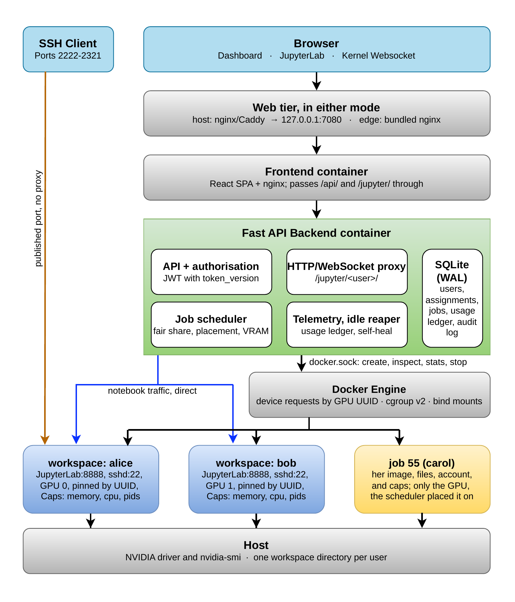

# GPU Platform — Multi-User GPU / CPU / RAM Management Platform

> This file is the reference: how the platform is built, what every setting
> does, and why. If you only want to get something done, start with the
> **[administrator guide](docs/admin-guide.md)** and the
> **[user guide](docs/user-guide.md)**.

---

## Overview

GPU Platform is a self-hosted web application for sharing one machine's NVIDIA
GPUs, CPU, RAM and disk between several people. An administrator hands out the
resources; each user gets a JupyterLab session of their own, with SSH into the
same place, and can only see what they were given.

It was written for the situation most research groups are actually in: one
workstation with a couple of cards in it, a handful of people who need them,
and nobody whose job is to run a cluster.

| Feature | Description |
|---|---|
| Multi-user login | Per-user accounts, JWT sessions, instant revocation |
| Self-service account | Users edit their own name and email, and change one password that covers the dashboard, SSH and Jupyter |
| GPU assignment | Admin pins GPU 0, GPU 1 or both to each user, enforced by the Docker device cgroup |
| Isolated JupyterLab | One container per user; kernels, terminals and SSH all work through one authenticated entry point |
| Resource monitoring | GPU, CPU, RAM, disk and per-user container usage, live |
| Quotas | Per-user disk budget, plus weekly GPU-hour and CPU-hour budgets on batch jobs, applied at submission and again while a job runs |
| Usage accounting | Durable ledger of every session: GPU-hours, peak RAM, why it ended |
| Audit trail | Every privileged action recorded with actor, target and IP |
| Idle reclamation | Optional automatic stop of sessions nobody is using |
| Flexible fronting | Runs behind your existing nginx/Caddy, or brings its own |

---

## Architecture



The Docker Engine is on the *lifecycle* path, not the *traffic* path: it
creates a container and is asked about it afterwards, while a notebook is
proxied straight to the container over the Docker network. The same picture is
Figure 1 of the article cited at the end of this file.

* The **frontend container** serves the SPA and proxies `/api` and `/jupyter` to
  the backend over the Docker network. In `HTTP_MODE=host` it *is* the public
  entry point, so nothing in the stack competes for ports 80/443.
* The **backend** owns authentication, assignments, quotas, accounting, the
  per-user container lifecycle, and proxies all Jupyter traffic (HTTP **and**
  WebSocket) so the browser never needs to know an internal port.
* **User containers** (`gpu-jupyter-<user>`, and `gpu-job-<id>` for a batch
  job) are pinned to specific GPUs by UUID through Docker device requests,
  capped with cgroups, and reachable only by DNS name inside the platform
  network. The exception is each workspace's `sshd`, which gets a published
  port from `SSH_PORT_START`–`SSH_PORT_END` because an SSH session cannot be
  carried over the HTTP proxy.

---

## Prerequisites

* **Docker** and **Docker Compose v2** (`docker compose`)
* **NVIDIA GPU(s)** with working drivers (`nvidia-smi`)
* **nvidia-container-toolkit** so containers can be given GPUs

> **Scope: GPUs without MIG.** A whole physical GPU is the unit the platform
> hands out, identified by UUID. It does not drive MIG instances and has not
> been tested on a card with MIG enabled. MIG is not available on GeForce-class
> cards, which is the hardware this targets, so a VRAM reservation here is
> enforced by measurement rather than by the hardware; see
> [Batch jobs](#batch-jobs-sharing-gpus-by-time).

### A machine without a GPU

The stack deploys on a host with no NVIDIA GPU and no nvidia-container-toolkit,
and a CPU-only machine is a perfectly reasonable thing to share this way — it is
also how you try the interface out or work on the code.

`deploy.sh` detects the missing GPU and changes nothing else: a workspace is one
container per user either way, so it still gets `memory.max`, `cpu.max`, the PIDs
cap, the I/O throttles, its own filesystem and its own SSH endpoint. Accounts, quotas, the batch queue (`submit --no-gpu`) and the whole web
interface work. The only thing absent is the card: the container comes up with
`NVIDIA_VISIBLE_DEVICES=void`, GPU assignment has nothing to assign, and a
per-user memory, core or CPU-second limit is set on its own — see
[Limits without a GPU](#limits-without-a-gpu). `.env` records the fact as
`CPU_ONLY=true`, which is what stops the GPU guard below from treating every
later deployment as a host that has lost its cards; `deploy.sh` clears it by
itself if a GPU ever turns up.

**Supported platform: Linux with cgroup v2.** That is where every limit
described here was verified. Docker Desktop (macOS, Windows) can start the stack
for trying out the interface, but its daemon runs inside a VM, there is no GPU
pass-through to the workspaces, and the read-only `/home` mapping is skipped
(`FORCE_HOME_MOUNT=1 ./deploy.sh` maps it anyway if you have shared the path
with the VM). It is not a supported way to run the platform for a group.

### Install nvidia-container-toolkit (Ubuntu/Debian)

```bash
curl -fsSL https://nvidia.github.io/libnvidia-container/gpgkey \
  | sudo gpg --dearmor -o /usr/share/keyrings/nvidia-container-toolkit-keyring.gpg

curl -s -L https://nvidia.github.io/libnvidia-container/stable/deb/nvidia-container-toolkit.list \
  | sed 's#deb https://#deb [signed-by=/usr/share/keyrings/nvidia-container-toolkit-keyring.gpg] https://#g' \
  | sudo tee /etc/apt/sources.list.d/nvidia-container-toolkit.list

sudo apt-get update && sudo apt-get install -y nvidia-container-toolkit
sudo nvidia-ctk runtime configure --runtime=docker
sudo systemctl restart docker
```

Verify: `docker run --rm --gpus all nvidia/cuda:12.0-base-ubuntu22.04 nvidia-smi`

---

## Quick start

From a Linux host with the [prerequisites](#prerequisites) to a first job:

```bash
git clone https://github.com/vudinhhong/gpu-platform.git
cd gpu-platform
./deploy.sh          # checks prerequisites, detects GPUs, builds and starts everything
```

1. Open the URL `deploy.sh` prints and sign in as `admin` with the password it
   printed (also in `.env` as `ADMIN_PASSWORD`). Change it: your name in the
   top right, then **Change password**.
2. **Admin → Users → Create user**, e.g. `alice`.
3. Optional: **Admin → Assignments** to give `alice` memory and core limits
   (and a GPU, if she needs one all day).
4. Sign in as `alice` and press **Start Jupyter**. JupyterLab opens in her own
   container; `limits` in its terminal shows what she holds.
5. In that terminal, queue a first job:

   ```bash
   printf 'nvidia-smi -L\nnproc\nfree -m\n' > hello.sh
   submit hello.sh --gpu-memory 2000     # or --no-gpu on a CPU-only host
   myjobs                                # then: cat output.<id>.out
   ```

You can run `deploy.sh` as often as you like. It builds the per-user Jupyter
image *before* starting the stack rather than at session start, which would
otherwise block the API for several minutes the first time somebody logs in. It
also reconciles `.env` with whatever the host currently looks like, and prints
the next step for the HTTP mode it picked.

Two things it does on the way:

**It snapshots before it starts.** `.env`, the database and the fully merged
compose configuration go to `data/backups/` first, last twenty kept. The
database copy is taken with `sqlite3 .backup` and not with `cp`: the database
runs in WAL mode, so a plain copy can silently leave out whatever is still in
the write-ahead log. The compose snapshot answers "was the GPU overlay actually
applied".

**It refuses rather than guessing.** If no usable GPU is detected on a host that
is not recorded as CPU-only, `deploy.sh` stops with an error. A transient
`nvidia-smi` failure is far likelier than a host losing its cards, and deploying
anyway would bring every workspace and every job up without the card its owner
was assigned — a platform that looks broken in a way that points at the wrong
layer. If the host really has no GPU, say so once:

```bash
FORCE_CPU_ONLY=1 ./deploy.sh
```

The answer is written to `.env` as `CPU_ONLY=true`, so the flag is not needed
again, and `deploy.sh` clears it by itself if a GPU reappears. Nothing else
changes: a container with no card attached keeps its own filesystem, its own SSH
endpoint and every limit that is not a GPU.

Once it is up, the [administrator guide](docs/admin-guide.md) walks through
first sign-in, accounts, quotas and the day-to-day jobs; hand your users the
[user guide](docs/user-guide.md).

---

## Deployment modes: with or without the bundled nginx

The HTTP entry point is configurable, because most GPU boxes are already
serving something on ports 80 and 443.

| | `HTTP_MODE=host` | `HTTP_MODE=edge` |
|---|---|---|
| Who owns :80/:443 | **Your existing** nginx / Caddy / Apache | The bundled `nginx` container |
| What the stack publishes | `WEB_BIND:WEB_PORT` only (default `127.0.0.1:7080`) | `:80` and `:443` |
| TLS | Your existing certbot / certificates | `nginx/ssl/` + `nginx/nginx.conf` |
| Compose files | `-f docker-compose.yml -f docker-compose.host.yml` | `-f docker-compose.yml --profile edge` |
| Use when | The machine already hosts other sites | Dedicated box, nothing else on those ports |

`deploy.sh` picks the mode automatically (host mode when port 80 is already in
use) and honours an explicit `HTTP_MODE` in `.env`.

**Two nginx layers, and why that is fine.** In host mode a request crosses two
of them: yours, then the one inside the frontend container that serves the
built SPA and proxies `/api/` and `/jupyter/`. The inner one is not
redundant, it is what makes the stack a single port you can point anything at,
and the cost is one loopback hop. What it does mean is that four things have
to agree at both layers, and the shipped
[`nginx/host/gpu-platform.conf`](nginx/host/gpu-platform.conf) already sets
them:

* **the WebSocket upgrade**, or JupyterLab loads and no cell ever runs;
* **`client_max_body_size`**, since the smaller of the two wins and the
  default 1 MB refuses any real dataset;
* **long `proxy_read_timeout` with `proxy_buffering off` on `/jupyter/`**, or
  a kernel is cut off mid-computation;
* **`X-Forwarded-For` set to `$remote_addr` at the OUTERMOST layer**. Use
  `$proxy_add_x_forwarded_for` there and whatever the client sent is kept and
  the platform's address appended, so the caller decides which IP lands in the
  audit log and which one the login throttle counts. Replacing it discards
  that claim; the inner layer then appends, and the first entry is the real
  caller again.

### Using the host's nginx (recommended on a shared machine)

```bash
# 1. .env
HTTP_MODE=host
WEB_BIND=127.0.0.1
WEB_PORT=7080

# 2. Start — no container touches :80/:443
docker compose -f docker-compose.yml -f docker-compose.gpu.yml \
               -f docker-compose.host.yml up -d

# 3. Host firewall: needed when the host defaults to DROP (see below)
sudo bash scripts/host_firewall_setup.sh --check
sudo bash scripts/host_firewall_setup.sh

# 4. Point your nginx at it
sudo cp nginx/host/gpu-platform.conf /etc/nginx/sites-available/gpu-platform
sudo nano /etc/nginx/sites-available/gpu-platform     # set server_name
sudo ln -sf /etc/nginx/sites-available/gpu-platform /etc/nginx/sites-enabled/
sudo nginx -t && sudo systemctl reload nginx

# 5. TLS
sudo certbot --nginx -d gpu.example.com
```

> **If the host firewall defaults to DROP, do step 3 or the site returns 504.**
> Containers sit on the Docker bridge `gpu-platform0` (the name is pinned in
> `docker-compose.yml` so firewall rules keep matching when the network is
> recreated). With `-P OUTPUT DROP` and no rule for that bridge, `docker-proxy`
> accepts the connection on loopback but cannot forward it to the container, so
> the reverse proxy times out. `deploy.sh` checks for this and names the fix.

`nginx/host/gpu-platform.conf` already contains everything Jupyter needs:
day-long timeouts and `proxy_buffering off` on `/jupyter/`, WebSocket upgrade on
both `/jupyter/` and `/api/` (the live-resource socket lives on `/api/gpu/ws`),
and a 2 GB upload limit.

> If another site on the host already defines `$connection_upgrade`, delete the
> `map` block at the top of the file — nginx allows only one definition per name.

### Using the bundled nginx

```bash
# .env: HTTP_MODE=edge
docker compose -f docker-compose.yml -f docker-compose.gpu.yml --profile edge up -d
```

Without `--profile edge` the `nginx` service is never created at all. That is
what keeps host mode safe: there is no container that could grab port 80 behind
your back.

---

## Configuration

All configuration lives in `.env` (start from `.env.example`).

### Core

| Variable | Default | Description |
|---|---|---|
| `SECRET_KEY` | *(generated)* | JWT signing **and** the key session secrets are encrypted with. Rotating it logs everyone out and invalidates stored session secrets. |
| `ADMIN_PASSWORD` | *(generated)* | Initial password for `admin`, generated per install by `deploy.sh` and printed once. Change it after the first login |
| `HTTP_MODE` | auto | `host` or `edge` (see above) |
| `WEB_BIND` / `WEB_PORT` | `127.0.0.1` / `7080` | Where the stack publishes itself in host mode |
| `BACKEND_BIND` | `127.0.0.1` | Bind address for the API port (debugging) |
| `GPU_COUNT` | `2` | Number of GPUs on the host |
| `ALLOW_MOCK_GPU` | `false` | Return simulated GPUs when `nvidia-smi` is unavailable. **Keep off in production** — phantom hardware let admins assign GPUs that do not exist |

### Sessions

| Variable | Default | Description |
|---|---|---|
| `JUPYTER_IMAGE` | `gpu-jupyter:latest` | Default per-user image |
| `JUPYTER_IMAGES` | *(empty)* | Allow-list users may choose from: `PyTorch=my/pytorch:2.3,TF=my/tf:2.16`. Anything outside it is rejected |
| `JUPYTER_DATA_DIR` | `/jupyter_data` | Per-user data root inside the backend |
| `JUPYTER_DATA_HOST_DIR` | *(set by deploy.sh)* | The same directory **as the Docker host sees it** — bind mounts are resolved host-side, so a stale value from another machine breaks every session |
| `KEEP_SESSIONS_ON_SHUTDOWN` | `true` | User notebooks survive a backend restart/update |

### Resource limits

| Variable | Default | Description |
|---|---|---|
| `DEFAULT_MEMORY_LIMIT_MB` | `8192` | RAM cap per user (cgroup `memory.max` on the workspace container) |
| `DEFAULT_CPU_CORES` | `2` | CPU-core cap per user container |
| `DEFAULT_CPU_LIMIT_SECONDS` | `0` | `RLIMIT_CPU`: CPU-seconds one process tree may burn before the kernel kills it. **Inert** — cgroups cannot express a cumulative budget, and nothing has applied this since the process backend was removed. Set cores with the assignment's *CPU cores* field and a compute budget with `DEFAULT_CPU_HOURS_QUOTA` |
| `CONTAINER_PIDS_LIMIT` | `512` | cgroup `pids.max` — the fork-bomb ceiling |
| `DISK_READ_BPS_MB` / `DISK_WRITE_BPS_MB` | `150` / `80` | Hard per-container I/O ceilings (MB/s) |
| `DISK_READ_IOPS` / `DISK_WRITE_IOPS` | `0` | Optional operation-count caps (useful on HDDs) |
| `BLKIO_WEIGHT` | `500` | Proportional share under disk contention. cgroup v1 only; skipped on cgroup v2 (see [Disk I/O](#disk-io)) |

### Quotas and lifecycle

| Variable | Default | Description |
|---|---|---|
| `DEFAULT_DISK_QUOTA_MB` | `0` | Per-user workspace budget; `0` = unlimited. Over budget, the GPU and the queue are refused, never the workspace itself |
| `QUOTA_PERIOD` | `week` | How long a time budget lasts before it refills: `week` (Monday) or `month` (the 1st) |
| `QUOTA_TZ_OFFSET_HOURS` | `0` | Hours east of UTC, so "refills on Monday" means the user's Monday. Hanoi = `7` |
| `DEFAULT_GPU_HOURS_QUOTA` | `0` | GPU-hours a user's **jobs** may spend per period, counted as hours × cards held; `0` = unlimited. Interactive sessions are not counted |
| `DEFAULT_CPU_HOURS_QUOTA` | `0` | CPU core-hours their **jobs** may spend per period, as hours × cores allocated; `0` = unlimited |
| `JOB_TIME_QUOTA_ACTION` | `requeue` | A **running GPU job** whose owner has run out: `requeue` puts it back in the queue to start again when the budget refills, `stop` fails it, `warn` lets it run |
| `JOB_TIME_QUOTA_CPU_ACTION` | `pause` | The same for a job holding **no GPU**: `pause` freezes it where it stands and the scheduler resumes it at the refill. Anything else falls back to the setting above |
| `QUOTA_REFRESH_INTERVAL_SECONDS` | `60` | How often a running workspace's copy of these figures is refreshed for its `limits` command. The budgets themselves are applied by the scheduler |
| `DISK_QUOTA_ACTION` | `warn` | What to do about a **running** session over its disk quota: `warn` (audit + flag) or `stop` |
| `IDLE_TIMEOUT_MINUTES` | `0` | Stop sessions with no traffic for this long; `0` = never |
| `REAPER_INTERVAL_SECONDS` | `300` | How often the idle reaper scans |
| `METRICS_INTERVAL_SECONDS` | `10` | Telemetry refresh (`docker stats` is blocking, so it runs in a worker thread) |
| `GPU_KEEPER_INTERVAL` | `120` | In-container GPU keep-alive interval |
| `SELF_HEAL_INTERVAL` | `30` | Dead-container rescan interval |
| `GPU_GUARD_INTERVAL` | `1` | How often VRAM is sampled and the reservation enforced. One `nvidia-smi` covers every job, so this does not get dearer as the queue grows. If that scan cannot run, the guard stands down and the scheduler's own `JOB_SCHEDULER_INTERVAL` cycle does the work instead |

Per-user overrides for all three quotas live in **Admin → Users** and win over
these defaults.

Sizing the two job budgets: capacity per week is `GPUs × 168` GPU-hours and
`(cores − JOB_CPU_RESERVED_CORES) × 168` CPU-hours. Divide by the number of
people who need the queue at once for an equal share, then round up, since a
budget is a ceiling against one person taking everything, not a ration everyone
is expected to spend. For example, two GPUs, 32 cores with four reserved, and
four active users give 336 / 4 = **84 GPU-hours** and 4704 / 4 ≈ **1200
CPU-hours** a week each.

### Security

| Variable | Default | Description |
|---|---|---|
| `ACCESS_TOKEN_EXPIRE_MINUTES` | `480` | JWT lifetime. Revocation does **not** depend on it |
| `MIN_PASSWORD_LENGTH` | `10` | Minimum password length (a letter and a digit are also required) |
| `COOKIE_SECURE` | `false` | Force the `Secure` flag on the Jupyter proxy cookie. Set `true` when TLS terminates upstream |
| `LOGIN_MAX_FAILURES` | `8` | Failures before lockout, counted per username **and** per IP |
| `LOGIN_FAIL_WINDOW_SECONDS` | `300` | Sliding window for the failure count |
| `LOGIN_LOCKOUT_SECONDS` | `900` | Lockout duration |
| `UNIFIED_PASSWORD` | `true` | One password per user: Jupyter and the container's UNIX account both accept the **platform account password** (see below) |
| `SSH_PASSWORD_AUTH` | `true` | Accept password auth over SSH at all. `false` = key-only |
| `SSH_ENABLED` | `true` | Per-user sshd inside user containers |
| `SSH_PORT_START` / `SSH_PORT_END` | `2222` / `2321` | Host port pool for user SSH |

---

## Usage

This section is the tour. Both roles have a task-by-task guide of their own:
the [administrator guide](docs/admin-guide.md) and the
[user guide](docs/user-guide.md).

### Admin

1. Sign in as `admin` and change the password immediately.
2. **Admin → Resources** — host CPU/RAM/disk, every GPU with the users on it,
   and a per-user table of CPU, RAM, disk and GPU-hours.
3. **Admin → Users** — create accounts and set each person's disk quota and
   their weekly GPU-hour and CPU-hour budgets for jobs.
4. **Admin → Assignments** — grant GPUs and per-user RAM / CPU caps. Every field is
   optional and at least one must be set, so a user can be capped on CPU and RAM
   without being given any GPU.
5. **Admin → Jupyter Sessions** — see and force-stop live sessions.
6. **Admin → Usage** — GPU-hours per user over 7/30/90 days plus every session.
7. **Admin → Audit** — logins, failures, user changes, assignment changes,
   session starts/stops/reaps, with actor and IP.

### User

1. **Launch JupyterLab** — the platform starts a personal container and opens
   `/jupyter/<username>/`. No token in the URL and no login prompt: the
   platform session is the authentication. Inside,
   `torch.cuda.device_count()` returns exactly the number of GPUs granted.
2. **Resource usage** card — live CPU, RAM, process count and disk I/O of your
   own session, plus your disk usage and how much of your job budget is left.
3. **Environment** — pick a Jupyter image when the platform offers more than one.
4. **SSH access** — the dashboard shows the port; sign in with **your account
   password**, or register a public key (which applies immediately, no restart).
5. **Jupyter password** — optional. Only needed to add a second factor in front
   of JupyterLab; by default your account password already works there.
6. **Your name, in the navbar, is a menu** — **Edit your details** and **Change
   password** open over the page you are on. Nothing behind them is lost, and
   changing your password neither signs you out nor interrupts the workspace
   you have running.
7. **Jobs** come in two tables. What is in flight is never paged, and shows
   what each job is placed on, how long it has run and, for a job that is
   waiting, why. The history below it is paged ten at a time, and since it
   gets long it can be narrowed to one status, searched by name or script, and
   sorted by clicking a column: id, status, name, runtime, when it was
   submitted or when it finished. Filtering and sorting happen on the server,
   so they cover the whole history rather than the page in front of you.
8. A job of yours may show as **Paused**. That is the platform holding it
   while you are out of CPU hours; it thaws by itself when the budget refills
   and carries on from the same point.

---

## Resource management

### One password per user

A user has one password, the one they log into the platform with, and it also
works for JupyterLab and for SSH into their container. There is nothing to
configure, no separate SSH password to copy off the dashboard, and no token in
any URL.

The account password is stored as bcrypt, which cannot be turned into the
formats Jupyter and sshd want. Rather than keep two more secrets around, the
platform derives what each of them needs at the moments the plaintext is
legitimately in hand: account creation, password change, admin reset, and a
successful login.

| Derived value | Format | Used by |
|---|---|---|
| `account_jupyter_hash` | `argon2:$argon2id$…` | Jupyter's `IdentityProvider.hashed_password` |
| `unix_password_hash` | `$6$…` (sha512-crypt) | the container's `/etc/shadow`, via `chpasswd -e` |

Neither digest is reversible, and the plaintext is never stored, logged or
handed to a container. Changing the password updates both and pushes the new
UNIX digest into the running container, so SSH picks it up straight away
without a session restart.

In practice Jupyter never asks for a password. The proxy has already
authenticated the request and presents Jupyter's own session token upstream, so
the user lands directly in JupyterLab. The derived password is there for the
uncommon case of reaching Jupyter's login form some other way, and the account
password is what works there.

Setting a password under *Jupyter password* on the dashboard is optional, and
it changes the meaning of that form. It becomes a real second factor: the proxy
stops vouching for you, and the form has to be satisfied even when you arrive
from the dashboard.

> **Worth knowing.** With `UNIFIED_PASSWORD=true` the account password also
> opens an SSH session on a port range that is reachable from the internet, and
> sshd does not go through the platform's login throttling and lockout. If that
> bothers you, have people register SSH keys and set `SSH_PASSWORD_AUTH=false`.
> Key-based login keeps working and the exposure goes away.

### GPU assignment

An administrator picks GPUs by index (GPU 0, GPU 1), because that is what
`nvidia-smi` shows. When the container is created the backend resolves each
index to the card's UUID with `nvidia-smi`, and the container is created with
a Docker device request naming those UUIDs. Only if `nvidia-smi` cannot
answer at that moment does the request fall back to the index, which the
NVIDIA runtime also accepts. That request becomes a device cgroup in the
kernel, so the container cannot see, open or use any other card no matter what
the user does to `CUDA_VISIBLE_DEVICES`. Inside the container the granted GPUs
are renumbered from 0.

We use UUIDs and not indices because the driver is free to reorder indices
(`CUDA_DEVICE_ORDER`, hot-plug, MIG), whereas a UUID always means the same
physical card.

### An assignment is not a share

Assigning GPU 0 to someone gives them **unrestricted** use of it. The VRAM they
take and how long they hold it are not capped, and their interactive time is
not charged to the job budgets. The only place an open workspace counts is the
fair-share score of that user's own *batch jobs*: a workspace holding a card
is charged as "what they hold now" (see
[fair share](#who-goes-next-fair-share-rather-than-first-come-first-served)),
so somebody sitting on an assigned GPU is not also first in the queue. That is correct for a person with sustained work who genuinely
needs a card all day. It is the wrong default for a group.

Jobs can still be placed on an assigned card, because placement only looks at
free VRAM (`JOB_GPU_POOL` is every GPU unless you narrow it). But the person
holding the card can allocate the rest of it at any moment, and the job that
landed beside them is the one that dies. From the queue's point of view an
assigned card is capacity it cannot rely on.

**So if you want the cards shared, assign them to nobody.** Give people limits
without a GPU — the assignment form allows exactly that, every field is
optional — and let them reach the hardware through `submit`. Then fair share
decides who runs next, every run is booked to the ledger, and an idle card goes
to whoever has used the least. Keep assignments for the exceptions and make
them justify themselves.

A reasonable arrangement for a group of ten:

| Who | What they get |
|---|---|
| One or two people with long, continuous training runs | A GPU assignment |
| Everybody else | Memory, core and process limits, no GPU, and the job queue |
| Nobody | An assignment "just in case", which is an idle card with a name on it |

### RAM, CPU, PIDs

cgroups (`--memory`, `--cpus`, `pids.max`) applied to the whole container, with
swap disabled so the memory cap cannot be evaded. Limits come from the user's
assignment and fall back to the platform defaults.

### Disk I/O

One person copying a dataset should not be able to starve everyone else.
There are two ways to arrange that, and in practice only the first is available:

| Control | Effect |
|---|---|
| `DISK_READ_BPS_MB` / `DISK_WRITE_BPS_MB` | **Hard ceiling** per container, in force whether or not the disk is busy |
| `BLKIO_WEIGHT` | **Fair share** under contention, so somebody working alone is not slowed down. Inert on cgroup v2; see below |

The backing block device is detected automatically. Settings the daemon
refuses are dropped with a warning instead of failing the session.

**`BLKIO_WEIGHT` does nothing on cgroup v2, and the platform does not send it
there.** This is worth spelling out because the variable is still in
`.env.example` and it looks like it works. `--blkio-weight` is a cgroup v1
control. On the v2 unified hierarchy Docker and runc will happily accept it and
convert it to `io.weight` (500 becomes 4950), but `io.weight` is only *honoured*
when the device runs the **BFQ** scheduler or has **blk-iocost** configured.
Neither is the default on a typical NVMe (`none`/`mq-deadline`, no iocost), so
the value would be written and then ignored. The platform therefore skips it,
`docker inspect` reports `BlkioWeight: 0`, and the read-back below shows no
weight rather than echoing the configuration.

None of this is about the hardware. It is the I/O scheduler and the cgroup
version. To get proportional sharing back you would enable one of:

```bash
# BFQ: designed for rotational and single-queue devices.  Works, but it costs
# CPU and throughput on fast NVMe, which is why it is not the default there.
sudo modprobe bfq
echo bfq | sudo tee /sys/block/nvme0n1/queue/scheduler

# blk-iocost: the cgroup v2 answer for fast devices.  Needs a cost model for
# the disk; see Documentation/admin-guide/cgroup-v2.rst.
```

Until then the hard ceilings are the whole story, so it is worth sizing them
against the disk you actually have rather than leaving the shipped defaults.
Measure it first, with direct I/O so the page cache stays out of the way:

```bash
dd if=/dev/zero of=probe bs=1M count=800 oflag=direct   # write
dd if=probe of=/dev/null bs=1M iflag=direct             # read
rm probe
```

Then divide by the number of people you expect to be copying data at the same
time. The defaults of 150/80 MiB/s are deliberately timid because the shipped
configuration has no idea what disk it will land on; on a modern NVMe they are
a small fraction of what the device can do, so if your disk is fast, raise
them.

### What is actually enforced

A limit a configuration file mentions is not a limit. What each one rests on:

| Limit | Mechanism | Exceeding it |
|---|---|---|
| RAM | cgroup `memory.max`, swap disabled | the kernel OOM-kills inside that container only |
| CPU | cgroup `cpu.max` | throttled to the core count |
| Processes | cgroup `pids.max` | `fork()` fails |
| Disk read / write | cgroup `io.max` | throttled to the cap |
| GPU | Docker device request by UUID (device cgroup) | other cards cannot be opened |
| **Disk space** | **none** | **measured, not enforced by the kernel, see below** |
| **VRAM of a batch job** | **none** | **measured, the job is stopped afterwards, see [below](#--gpu-memory-decides-everything-and-is-held-to)** |

`scripts/experiments/` contains the probes that check each row from inside a
live workspace and print what they measured.

Don't trust the settings, read back what was actually applied per user:
`GET /api/user/me/resources` → `enforced`, and **Admin → Resources** shows the
same thing. A Docker daemon that rejects a setting drops it and starts the
container anyway, so echoing the configuration would report limits that
nothing on the machine is applying.

### Why the standard tools report the wrong numbers

`df`, `free`, `nproc` and `top` are not cgroup-aware. They read machine-wide
values out of `/proc` and `/sys`, so a properly limited workspace will happily
tell you it has every CPU on the machine, all of its RAM and the whole shared
disk. (Those `tmpfs` lines `df` used to print were runc masking sensitive
`/sys` paths, not storage.)

The workspace therefore ships cgroup-aware replacements on `PATH` ahead of
`/usr/bin`. They report the allocation rather than the machine, and the real
ones are still there as `/usr/bin/<name>`:

| Command | What it reports |
|---|---|
| `limits` | The full allocation (also printed on every interactive SSH login) |
| `nproc` | Allocated cores, so `make -j$(nproc)` sizes itself correctly |
| `free` | Allocated memory, in the real `free` layout |
| `df` | The workspace with its allocated size; internal pseudo-mounts are dropped |
| `top` | The allocation, then the real `top` |

```
Your workspace
----------------------------------------------------------
  Memory        70.8 MiB used of 2.9 GiB
  CPU           2 cores
  Processes     8 of 512
  Disk speed    read 150.0 MiB/s, write 80.0 MiB/s
  Disk space    0 B used of 4.9 GiB (0%)
  GPU           NVIDIA GeForce RTX 4090, 49140 MiB
----------------------------------------------------------
```

Everything a user sees is written from where they sit. As far as they are
concerned the workspace is their machine, and nothing in front of them talks
about hosts, containers or cgroups. That kind of detail belongs in the admin
views and the server log, where somebody can actually do something with it.

### The shell

Terminals, both JupyterLab's and SSH, run bash with a colour prompt, tab
completion and history. `SHELL` has to be set in the image: JupyterLab launches
`$SHELL` and otherwise falls back to `/bin/sh`, which on Ubuntu is dash. You
get a bare `$` prompt, no colours and no completion, and it looks broken.

The image carries the things a shell needs to feel like one:
`bash-completion`, `procps` (`ps`, `top`, `free`), `git`, `less`, `nano`,
`vim`, `wget`, `unzip`, `bzip2`, `xz-utils` and `rsync`. The prompt reads
`you@workspace`.

Anything else goes in with `pip install`, which persists in `.local`, or by
installing into the workspace. Miniconda works fine:

```bash
curl -fsSLO https://repo.anaconda.com/miniconda/Miniconda3-latest-Linux-x86_64.sh
bash Miniconda3-latest-Linux-x86_64.sh -b -p ~/miniconda3
```

> The cgroup-aware `df` and `free` only rewrite the plain interactive forms
> (`df`, `df -h`, `free -m`). Any other option, such as `df -Pk` or `free -w`
> or anything else a script would use, goes to the real tool untouched, because
> installers do arithmetic on that output.
>
> [LXCFS](https://github.com/lxc/lxcfs) solves the same problem at the `/proc`
> level, for every program rather than four commands. The platform does not
> depend on it because it is a host daemon outside Docker that every node would
> need installed and kept running, and because it cannot report the platform's
> own budgets (disk quota, job hours). The wrappers and LXCFS do not conflict.

### Disk space is a soft quota

There is no filesystem quota here. `jupyter_data/<user>` is a plain bind
mount, so nothing in the kernel stops a user filling the host disk, and `df`
inside the container shows that whole disk because it really is the disk they
are writing to.

What the platform does instead:

* refuses to **start** a session for a user already over quota;
* re-checks every running session on the reaper interval and follows
  `DISK_QUOTA_ACTION`: `warn` records it in the audit log and flags the user
  under **Admin → Resources**, while `stop` also stops the session and frees
  the GPU;
* shows the real figure in `platform-limits` and on the dashboard.

If you want hard enforcement you need a filesystem that can do it: XFS or
ext4 project quotas on the partition holding `JUPYTER_DATA_DIR`, or a volume
per user. That is a storage decision on the host, and not something the
platform can impose from inside a container.

### Quotas

* **Disk**: `du` of `jupyter_data/<user>` against their budget, cached.
* **Job GPU hours**: wall clock × GPUs held, for batch jobs.
* **Job CPU hours**: wall clock × cores allocated, for batch jobs.

The two time budgets cover **the queue, and nothing else**. A workspace is
somebody's own seat at the machine: they opened it, they are sitting in front
of it, and their assignment already bounds what it may hold at any moment. The
queue is the opposite, work handed over in bulk to run unattended, where one
person with a loop that submits fifty jobs takes the machine from everybody
else without meaning to. So an interactive session costs nothing here. (A
session left open and unused is a real problem, but it is
`IDLE_TIMEOUT_MINUTES`' problem, not the budget's.)

They run per period, a week by default (`QUOTA_PERIOD`, refilling at local
midnight on Monday; set `QUOTA_TZ_OFFSET_HOURS` so "Monday" means the user's
Monday). A job is charged for what it *holds*, not for what it manages to use:
an hour on two GPUs is two GPU-hours and an hour of a four-core job is four
CPU-hours, busy or idle, because holding the hardware is what denies it to
somebody else. A job still running counts as it goes, so a three-day run cannot
outrun the budget it started inside, and a job that straddles a Monday is split
between the two weeks.

Two gates, both reading the same figures:

* **Submitting**: refused with 429, naming the budget and the day it refills.
  Being over the disk budget refuses a job too, since a job only adds output;
  it never refuses a workspace, which is the only place a user can delete files
  from.
* **Already running**: the scheduler checks on each pass, and what happens
  next depends on whether the job holds a card.
  * **A CPU-only job is frozen** (`JOB_TIME_QUOTA_CPU_ACTION=pause`, the
    default). Every process in it stops where it stands, and the scheduler
    thaws it when the period refills, so nothing is re-run and nothing is
    lost. Its clock stops with it: the stretch it had run is booked at that
    moment, and the days it spends frozen cost it nothing.
  * **A GPU job is stopped and put back in the queue**
    (`JOB_TIME_QUOTA_ACTION=requeue`, the default), where it starts again by
    itself at the refill. The time it did run is still booked, so a requeue is
    not a way to use the machine for free, and the script re-runs from the
    beginning and rewrites its output file, so a long run should checkpoint.
    `stop` marks it failed instead and leaves resubmission to the user; `warn`
    notes it and lets it run.

A job the scheduler is holding says why under `queue <id>`, and the same
sentence appears on the dashboard and in `limits` inside the workspace, where
the figures are refreshed every `QUOTA_REFRESH_INTERVAL_SECONDS`.

> **Why is a GPU job not frozen too?** `docker pause` keeps the container's
> memory, which on a CPU job is RAM and on a GPU job is a whole card's VRAM.
> A frozen GPU job would take the hours off its owner's budget without the card
> ever going back to anybody, and somebody could park one across the reset and
> hold a GPU all week for free. Requeueing gives the hardware back; the cost is
> the lost progress, which a checkpoint fixes and a locked-up card does not.

### Idle reclamation

The proxy stamps `last_activity` on real traffic (throttled to one write per
user per minute). With `IDLE_TIMEOUT_MINUTES` set, the reaper stops sessions
past the threshold, closes their usage record with reason `idle` and writes an
audit entry.

### Usage accounting

One `usage_records` row per session lifetime: GPUs held, image, backend, start,
end, GPU-seconds, peak RAM and end reason (`user`, `admin`, `idle`, `died`,
`deleted`). This is what **Admin → Usage** and the GPU-hour quota read.

### Who is on which GPU

`nvidia-smi` reports host PIDs. The backend runs in the host PID namespace
(`pid: host` in `docker-compose.gpu.yml`), so it maps each PID to its container
through `/proc/<pid>/cgroup`, and to the user who owns that container; this is
what puts an owner's name next to each compute process and what the VRAM guard
reads. The security cost of `pid: host` is discussed under
[Security model](#security-model). Command lines
are redacted before display, because a Jupyter process carries its session
token in `argv`.

---

## Batch jobs: sharing GPUs by time

Assignments are static. Either you hold a card or you do not, and meanwhile an
idle card sits there while somebody with no assignment has nowhere to run. The
job queue is what turns the same hardware back into something shared.

Anyone can submit, whether or not they hold a GPU assignment. The scheduler
keeps the job waiting until a card has room for what it asked for, then runs it
under exactly the caps its owner's workspace gets.

### From a terminal in your workspace

```bash
$ submit train.sh --gpu-memory 20000 --name nightly
job 12 submitted  [queued]
  position in queue : 1
  asking for        : 1 GPU x 20000 MiB
  output            : experiments/output.12.out

Watch it with:  myjobs
See what is ahead of it:  queue

$ queue
GPUs
  GPU 0    2140 MiB free of 49140 MiB   2 running
  GPU 1   44210 MiB free of 49140 MiB   0 running
  CPU       11.5 of 28 cores free

   ID  STATUS     GPU         RUNTIME    WAITED  USER         NAME
   50  running    0            21h30m       12s  alice        eld-sweep
   55  running    0             3h10m     5m40s  bob          ldg-collect
   57  queued     2x40000M          -    15m00s  carol        finetune-qwen
   58  queued     cpu               -     2m00s  alice        prep

2 running, 2 waiting.

$ queue 57          # one of your own, in detail
$ queue -m          # only your own rows of the queue
$ cancel 12 13 14   # one or several at once
```

**`queue` is the shared queue, not your inbox.** It lists every user's running
and waiting work, because the question it answers is "would a job submitted now
start, or sit behind eleven others?" — and your own jobs are the one part of
that which does not matter. Crossing user boundaries means it carries only
public columns: id, status, GPUs, runtime, how long it has waited, who owns it
and what they called it. Never a script, a path or a line of output.

`queue <id>` opens one of **your own** jobs. Another user's id is refused by
name rather than pretended out of existence — the queue above already listed
it, so hiding it would only send you hunting for a typo you did not make.

A job that is still waiting reports **why**:

```
$ queue 57
job 57  finetune-qwen
  status     : queued
  position   : 1 in the queue
  waiting    : 15m00s
  why        : waiting for GPUs: it needs 2 cards with 40000 MiB free each, and 1 have that much
  asking for : 2 GPU x 40000 MiB
  time limit : 600 minutes
```

That reason is produced by replaying the dispatcher over the real state
without touching anything, which is the only honest way to answer it: whether
a job can start depends on what the jobs *ahead* of it will take, so asking
about one job in isolation would report room right up to the moment the job in
front takes it. The reasons are the dispatcher's own — not enough free VRAM,
not enough cores, the owner already at their running limit, out of budget — or
nothing at all, which means it starts on the next pass.

`queue` is deliberately not your inbox, so the other half is its own command:
**`myjobs`** lists your own work, newest first, finished ones included, with
the details that are yours to see. (Not `jobs`: that is a shell builtin for
job control, so a command under that name could never be typed.)

```
$ myjobs
   ID  STATUS     GPU         RUNTIME  NAME                   OUTPUT
   58  queued     q:2               -  prep                   exp/output.58.out
   50  running    0            21h30m  eld-sweep              eld_server/output.50.out
   49  failed     1             5m12s  eld-sweep              eld_server/output.49.out
   46  succeeded  0               22s  prepare-data           exp/output.46.out

Showing 25 of 55. All of them:  myjobs -n 55
3 of your jobs are running or waiting — `queue` shows the whole queue they are in.
```

Every one of these endpoints requires the caller to be authenticated — with
the platform JWT from the dashboard, or with the job credential the platform
writes into the workspace. The shared queue crosses user boundaries, which
makes it exactly the endpoint that would be tempting to leave open, so a test
asserts that all six job routes answer an anonymous caller with 401 and leak
no username while doing it.

| Command | Does |
|---|---|
| `submit <script.sh>` | Queue a script. `--gpu-memory MiB` (required for a GPU; without it the job runs on CPU), `--gpus N`, `--no-gpu`, `--name`, `--max-minutes N` |
| `queue` | The shared queue — everyone's running and waiting jobs, public columns only. `queue <id>` for one of your own in detail; `-m` for just your rows |
| `myjobs` | Your own jobs, newest first, finished ones included. `-n N` (default 25), `-a` active only, `-f` finished only |
| `cancel <id> [...]` | Cancel one or several; reports anything it skipped and why |

The commands authenticate with a credential the platform drops into the
workspace, so there is nothing to type or remember, and it is rotated every
time the workspace starts.

### What a job runs as

A job runs in a container built from the same code path as its owner's
workspace: same image, same files, same account, same limits.

* `$HOME` is the workspace (`/home/<username>`, or the mapped home's own
  path; `/workspace` is a symlink to it), the working directory is wherever
  `submit` was run,
  and the script is executed through a login shell, so `pip install --user`
  packages and anything in the user's profile are already there.
* Memory, CPU cores, process count and disk-I/O caps come from the owner's
  assignment, same as their interactive workspace.
* Only the GPUs the scheduler placed it on are visible, pinned by UUID.
* It can only see its owner's files.

Output goes to `output.<job id>.out` in the directory the job was submitted
from. It is written as the job runs, so `tail -f` works, and it is owned by the
user.

### Who goes next: fair share rather than first-come-first-served

Serving the queue in submission order serves whoever asked for the most, first.
One user submits ten jobs, another submits one a minute later, and FIFO makes
the second person wait for all ten. That is the opposite of sharing.

So each user carries a score, in GPU-seconds, and the lowest score goes next:

```
score = recent usage (decayed)  +  what they are running right now
```

* **Recent usage** is their GPU-seconds and CPU-seconds over the last
  `FAIRSHARE_WINDOW_HOURS`, halved every `FAIRSHARE_HALFLIFE_HOURS` so that a
  busy morning does not follow somebody around for the rest of the week.
* **What they hold now** is charged as though each running job will keep going
  for `FAIRSHARE_LOOKAHEAD_SECONDS`. This is where the interleaving comes
  from: the moment a job is admitted its owner's score goes up, so the next
  pick lands on somebody else.
* **CPU counts too**, converted with `FAIRSHARE_CPU_CORE_WEIGHT`. A CPU-only
  job takes up real capacity, and ignoring it would let one person tie up the
  machine with work that happens not to touch a GPU.
* **Ties fall back to submission time**, so within a single user the queue is
  still first-come-first-served.

The case above, user A submitting ten jobs and user B one afterwards, with
`JOB_MAX_RUNNING_PER_USER=2`:

```
RUNNING:  job 1  _userA  A-1
          job 2  _userA  A-2        ← A's per-user limit
          job 11 _userB  B-only     ← submitted 11th, started 3rd
queued:   A=8    B=0
```

B did not wait behind ten jobs. `JOB_MAX_RUNNING_PER_USER` caps how many
slots one person can hold at once, and fair share decides who gets the next
free one. `queue` shows the position in *this* order rather than arrival
order, and **Admin → Job Queue** breaks each user's score into its two parts.

### Jobs without a GPU

`submit script.sh --no-gpu` queues work that needs no GPU at all. Such a job
is admitted against CPU capacity instead: `JOB_CPU_POOL_CORES`, which defaults
to every core on the machine minus `JOB_CPU_RESERVED_CORES`. That accounting
counts running jobs and open interactive workspaces together, so batch work
cannot squeeze out the people who are actually sitting at their keyboards. The
container gets no GPU injected, not even a hidden one.

Holding no card is also what lets one of these be **paused** rather than
stopped when its owner runs out of CPU hours: it freezes where it stands, gives
its cores back, and the scheduler thaws it at the refill. A frozen job still
counts against `JOB_MAX_RUNNING_PER_USER`, since it is going to want its slot
back, and it holds no cores in the capacity figure while it waits.

### What is recorded

Every job row is kept: who submitted it, the script, what it asked for, where
it ended up, its exit code and its timings. Every run also writes a usage
record carrying GPU-seconds and CPU-seconds, whether it was an interactive
session or a job and whether or not it touched a GPU. From that:

* users see their own consumption on the dashboard and via
  `GET /api/user/me/usage`;
* **Admin → Usage** reports GPU hours, CPU hours, job counts and outcomes per
  user over 7 / 30 / 90 days;
* the weekly GPU-hour and CPU-hour budgets read the job rows of the same
  ledger; interactive rows are reported but never charged.

> Usage history belongs to the user row and is removed with it. Export the
> usage report before deleting an account whose numbers you want to keep.

### Shared memory

Docker gives a container 64 MB of `/dev/shm`, which is nowhere near enough
for anything that moves data between processes through shared memory. A PyTorch
`DataLoader` with `num_workers` exhausts it straight away and its workers die.
What the user sees is `ConnectionResetError: [Errno 104] Connection reset by
peer` coming out of `multiprocessing`, which looks for all the world like a bug
in their own code.

Workspaces and jobs get `CONTAINER_SHM_SIZE_MB`, 2 GiB by default, capped at
half the memory limit because tmpfs pages come out of the same cgroup budget —
so the figure applied is `min(2 GiB, memory limit / 2)`, and on a workspace
capped at 10 048 MiB that is 2 GiB, not 5 024.
`df` shows `/dev/shm`, so running out of it is something you can diagnose
instead of something mysterious.

### `--gpu-memory` decides everything, and is held to

A job that names no VRAM figure is a CPU job. A job that names one gets a
GPU and is held to that figure. There is no default and nothing is guessed:

| What you type | What you get |
|---|---|
| `submit prepare.sh` | CPU only, starts when cores are free |
| `submit prepare.sh --no-gpu` | the same, said out loud |
| `submit train.sh --gpu-memory 20000` | 1 GPU, 20 GB |
| `submit train.sh --gpu-memory 20000 --gpus 2` | 2 GPUs, 20 GB **on each** |
| `submit train.sh --gpus 2` | refused: `--gpus` needs `--gpu-memory` |

There is deliberately no default figure: a number nobody chose still reads as a
decision, and the scheduler would fit other work against it.

The figure is enforced. These cards cannot partition memory in hardware, since
MIG is not available on consumer GPUs and `nvidia-smi` says as much
(`mig.mode.current = [N/A]`), so nothing in the driver will hold a job to its
word. The platform does instead: every `GPU_GUARD_INTERVAL` seconds, one second
by default, it reads what each job holds and stops any job past its allowance,
telling it what it really used.

This is sampling, not prevention. Nothing stops the allocation itself, so a job
is only seen once the driver has handed the memory over, and frameworks take
memory in large blocks: a single allocation can carry a job from under its
allowance to well past it. Sampling faster does not close that gap; the residual
is the size of one allocation, not the length of the interval.

> Stopped: it was holding 30000 MiB of GPU memory after asking for 4096 MiB, and
> the scheduler had fitted other work beside it on that figure. Run it again
> with --gpu-memory 30208.

Without enforcement a smaller request is placed sooner, and the job admitted
into the space another job claimed not to need is the one that runs out of
memory. Stopping the overrunning job puts the cost on the job that caused it.

The allowance is `max(request × JOB_GPU_OVERRUN_FACTOR, request +
JOB_GPU_OVERRUN_GRACE_MB)`, which is 1.1 and 1024 MB by default. The factor
forgives a request that was merely a bit low. The flat grace covers what the
job never chose in the first place: a CUDA context is several hundred megabytes
per process before a single tensor exists, and `nvidia-smi` counts it.
`queue <id>` prints the resulting limit, because being stopped by a threshold
nobody ever showed you is unfair.

What gets measured is memory held, not memory live. Some of it may be a
framework's free list rather than tensors, since PyTorch's caching allocator
hangs on to blocks after the tensors are gone. A cached block is still checked
out of the driver and still unavailable to the neighbour, though, and the
neighbour is the side that matters here.

`JOB_GPU_OVERRUN_ACTION=warn` puts it back to a note on the job without
stopping it, for deployments that would rather finish a run than keep
reservations honest.

How it is measured: one host-wide `nvidia-smi --query-compute-apps` per
interval, each PID mapped to its container through `/proc/<pid>/cgroup` (see
[Who is on which GPU](#who-is-on-which-gpu)). One query covers every card and
every job, so the cost does not grow with the queue. If the backend is not in
the host PID namespace the driver hides those processes; the guard then reports
that it cannot measure and stands down, rather than reading an empty list as
"every job holds nothing".

### Reading a job's output safely

Job output can be gigabytes — a training run printing a line per step — so the
platform never reads the file. It seeks to the end and takes the last
`JOB_OUTPUT_TAIL_BYTES` (128 KB), then the last `JOB_OUTPUT_TAIL_LINES` (500)
lines of that. Memory used is bounded by the window, not by the file. The response says how big
the file really is and that it was truncated, and points at `tail -f` for the
rest.

Terminal control sequences are stripped and progress bars collapsed to their
final state. A bar that rewrites one line with `\r` would otherwise arrive as
hundreds of frames and eat the whole line budget. One pathological line is cut
at `JOB_OUTPUT_MAX_LINE_CHARS`.

The file lives in a directory its owner controls and is read by a backend
running as root, so the path goes through a layer that refuses to leave the
workspace. Realpath containment catches a symlinked parent directory, and
`O_NOFOLLOW` catches the file being swapped for a link after the check. Every
file the platform writes into a workspace goes through the same layer:
`authorized_keys`, the Jupyter config, the limits file, the job token. Each of
them was just as good a way to make root write somewhere it should not.

### Progress bars, and how output is written

The script's stdout and stderr are redirected straight into
`output.<id>.out` by the shell that runs it. No pipe, no `tee`, and nothing in
the platform reads the stream; the backend only stats the file and reads its
tail when somebody asks. The output is written exactly once.

A progress bar that rewrites one line with `\r`, which covers tqdm and most C
tools, is one line in the file. The dashboard collapses it to its final state, so a bar
drawn a million times still shows up as one line. A tool that notices it is not
writing to a terminal and prints a line per update really does produce a line
per update, and nothing can distinguish those from genuine log lines, which is
why the view shows the last 500 of them instead of trying.

Buffering the output would save little CPU, would not change the number of
bytes written (which is what lands in the user's disk quota), and would delay
`tail -f`, which is how people watch a job. So the direct write stays.

The volume can still matter: a fast `\r` progress bar writes a steady stream
that is far below the container's write cap but adds up against its owner's
disk quota over a long run.
Past `JOB_OUTPUT_WARN_MB` the job carries a note saying so, which shows up in
`queue` and on the dashboard. `JOB_MAX_OUTPUT_MB` stops such a job outright and
is off by default, because killing a twelve-hour training run over a verbose
log is worse than the log. On the user's side the fix is one argument,
`tqdm(..., mininterval=10)`.

### How placement works

Jobs are considered oldest first, but the queue does not head-block. A job
asking for more VRAM than any card has free right now is skipped, and a later,
smaller job runs instead. Placement counts two things and takes whichever is
larger: what `nvidia-smi` reports as used, and what already-admitted jobs are
entitled to. The first covers work happening outside the platform, the second
covers a job that has started but not yet allocated. Together they stop two jobs
being admitted into the same free space.

The second figure is the *allowance*, not the request. A job holding a little
more than it asked for is inside its allowance and is deliberately not stopped,
so that margin is not free space: a job that has not allocated yet may grow into
it later, and the job admitted beside it on the strength of the smaller figure
is the one that would die of it. The card is therefore packed a little less
tightly — up to the grace per job is held back — which is what makes the grace
real rather than borrowed from a neighbour. `reserved_mb` in the API stays the
sum of the requests, the figure users chose and recognise; only placement uses
the allowance.

A job's request is a reservation for its whole lifetime, so asking for far more
than you need wastes the card for everybody. GPU time spent by jobs is booked
against the owner's weekly GPU-hour and CPU-hour budgets.

Admins see the whole queue under **Admin → Job Queue**, with what each job asked
for, where it landed, and a cancel button for reclaiming a card.

---

## A workspace is a container

There is one way to run a workspace: a Docker container of its own, holding
JupyterLab and an sshd, attached to the platform network and reachable only
through the backend. Everything the platform promises a user rests on that —
`memory.max` and `cpu.max` on the whole container rather than on one process,
`pids.max`, the I/O throttles, a GPU pinned by UUID through a device cgroup, a
filesystem nobody else can see, and `docker stats` for telemetry. It needs
`/var/run/docker.sock` in the backend and `gpu-jupyter:latest` pre-built, both
of which `deploy.sh` arranges.

### GPUs that "detach after a while"

There are two different faults behind that sentence, and they want different
fixes.

**The driver going idle.** When the last client disconnects, the driver can
tear an idle GPU down and take the CUDA contexts with it. Three layers push
back:

1. **On the host**, `sudo bash scripts/host_gpu_setup.sh` turns on persistence
   mode, sets `NVreg_PreserveVideoMemoryAllocations=1`, and installs a udev
   rule and a systemd timer.
2. **Inside the container**, `gpu_keeper.sh` pokes `nvidia-smi` every
   `GPU_KEEPER_INTERVAL` seconds.
3. **Self-heal**: the backend rescans containers every `SELF_HEAL_INTERVAL`
   seconds and restarts anything that exited, OOM kills included.
4. **GPU guard**: every `GPU_GUARD_INTERVAL` seconds one host-wide
   `nvidia-smi` is mapped back to containers through `/proc/<pid>/cgroup`, and
   any job past its allowance is stopped (see
   [`--gpu-memory`](#--gpu-memory-decides-everything-and-is-held-to)).

**systemd revoking the device.** The more common one, and it is not the driver
at all. The NVIDIA runtime hook grants a container access to `/dev/nvidia*`
after the container has been created, without telling the daemon, so Docker
never records those devices and systemd never hears about them. The container
runs under a transient scope with `DevicePolicy=strict`, and the next time
systemd reapplies that scope's device policy, which an ordinary `systemctl
daemon-reload` during an apt upgrade is enough to cause, the NVIDIA devices are
not on the list and are revoked from a container that is still running. The
host stays perfectly healthy, the device nodes are still in the container's
`/dev`, and everything inside fails with *Failed to initialize NVML: Unknown
Error*. It looks exactly like hardware disappearing, and it is why "the
platform cannot see the GPUs but `nvidia-smi` on the host is fine" is the shape
this arrives in.

The platform names the device nodes in the container spec, so the daemon
records them and systemd reapplies them rather than dropping them. Which nodes
are named is decided per container: the control nodes plus `/dev/nvidia<minor>`
for the assigned cards only, with the minor read from the driver rather than
assumed equal to the index, so nothing is widened. The backend's own nodes come
from an override `deploy.sh` generates from the host. To check a running
container:

```bash
CID=$(docker inspect -f '{{.Id}}' gpu-jupyter-alice)
systemctl show "docker-$CID.scope" -p DeviceAllow | tr ' ' '\n' | grep 195:
```

Entries there mean it is protected. A container that has already lost its
devices has to be recreated (stop and start the workspace), because nothing
inside can grant itself the device back.

**And when the reading fails anyway**, the platform says so instead of
reporting an empty machine. It keeps the last good figures, marks them stale,
shows an administrator what the error was and how long it has been going on,
and stops the scheduler placing GPU work against numbers it cannot refresh. A
queued job says the same thing in its own words rather than claiming the cards
are full.

### SSH access to user containers

With `SSH_ENABLED=true`:

```bash
ssh -p <port> <username>@<server-ip>
```

* The port appears on the dashboard; sign in with the account password or a
  registered key. The port comes from `SSH_PORT_START`–`SSH_PORT_END` and is **assigned on the
  user's first start and then kept**: stopping and restarting a workspace gets
  the same port back, and ports already assigned are not offered to anybody
  else. A client keys `known_hosts` by host *and* port, so a moving port reads
  to the user as `REMOTE HOST IDENTIFICATION HAS CHANGED`. The pool takes a port
  back only when the account is deactivated or moved to the trash.
* **Public keys** — paste an OpenSSH key on the dashboard; it is written to
  `/platform/authorized_keys` and applies immediately. Password auth remains
  as a fallback unless `SSH_PASSWORD_AUTH=false`.
* **Hardening** (`sshd_tail.conf`): `DisableForwarding yes` blocks tunnelling
  into the Docker network, root login is off, keep-alives hold long sessions.
* Ports `2222–2321` must be open in the firewall.

### Updating the environment

Rebuilding `gpu-jupyter:latest` does nothing to a workspace that is already
running. You have to stop and start it, which makes the platform remove the old
container and create a new one from whatever the tag points at now. A *restart*
is not the same thing: the self-heal loop, or Docker's restart policy after a
crash, reuses the existing container and keeps its original image. That is how
a workspace ends up quietly running something months old.

The dashboard will tell you. A running workspace whose image is no longer the
current one shows *"A newer environment is available."* Files and
`pip install --user` packages live in the workspace volume and survive the
swap untouched.

### Using a directory that already exists

Somebody who already has a home directory on this machine can be pointed at it
instead of being given a fresh workspace. Nothing is copied; the directory is
mounted as their workspace and the files stay exactly where they are.

Set it under **Admin → Users → Home directory** (`/home/alice`) and start the
stack with `-f docker-compose.homes.yml`, so the backend can see the same
paths. It mounts them read-only, since it never writes there.

| | |
|---|---|
| **The account adapts to the files** | The container account is created with the uid and gid that already own the directory, not the platform's usual 1000. Nothing is re-owned: chowning somebody's home to the platform's uid would take their own files away from them on the host. |
| **The platform writes nothing into it** | Its bookkeeping — the job token, the limits file, the SSH key it installs, the Jupyter config — lives in a separate directory mounted at `/platform`. sshd reads `/platform/authorized_keys` *in addition to* `~/.ssh/authorized_keys`, so a real one is never truncated. |
| **An administrator names it** | Never inferred from the username. |

That last row is the one that matters. `/home` on a typical machine holds
accounts with sudo. Map automatically whenever `/home/<username>` happens to
exist and registering the platform account `ubuntu` mounts `/home/ubuntu`;
writing an SSH key into it is then a shell on the host as a sudoer. Whether
platform user *alice* is the same person as host user *alice* is a judgement
call, and an administrator is the only one who can make it. So the field is
theirs to fill in, and all the platform checks is that the path sits under
`HOME_MOUNT_ROOT`, exists, and does not belong to root or a system account.

### Persistent data and installed libraries

SSH and JupyterLab share one directory. The user's home *is* the directory the
notebook browser serves, and it appears inside the container at
`/home/<username>` (or, for a [mapped home](#using-a-directory-that-already-exists),
at the path it has on the host, because conda, pip and virtualenvs record
absolute prefixes). `/workspace` is a symlink to the same directory, so a file you create in a terminal is the same file
JupyterLab lists. There is no second tree and no hidden folder to go looking
for.

| Host (`jupyter_data/<user>/`) | In container | Contents |
|---|---|---|
| `<user>/` | `/home/<username>` (`$HOME`; `/workspace` links to it) | Notebooks, datasets, code, and the dotfiles too: `.local` (`pip install --user`), `.ssh`, `.jupyter`, `.cache` |
| `<user>/.ssh_host_keys/` | `/etc/ssh/host_keys` | Stable SSH host keys |

Dotfiles stay out of the way: JupyterLab runs with `allow_hidden_files: false`,
so the file browser shows only the user's own work.

The entrypoint runs Jupyter with `HOME` set to the workspace and `PIP_USER=1`, so
user-installed libraries survive container recreation. The exceptions are
things that belong in the image itself, like CUDA stacks and `apt` packages;
for those, build a custom image and add it to `JUPYTER_IMAGES`.

---

## Security model

`CUDA_VISIBLE_DEVICES` on its own is not a boundary, because a user can
spawn a process with a different value. The isolation here is layered:

| Layer | Mechanism |
|---|---|
| GPU device access | Docker device request pinning GPU UUIDs — a kernel-level device cgroup, not an environment variable |
| GPU visibility | `CUDA_VISIBLE_DEVICES`, renumbered from 0 inside the container |
| RAM / CPU / fork bombs | cgroups `--memory`, `--cpus`, `pids.max` on the whole container |
| Disk | Per-container BPS/IOPS ceilings; per-user disk quota (measured, not a filesystem quota) |
| Process identity | Unprivileged per-user account inside the container; `no-new-privileges` |
| Network | Jupyter is never published; only the backend reaches it, by Docker DNS |
| Platform auth | JWT with a `token_version` claim — deactivation, password reset or an admin-flag change revokes live tokens at once |
| Proxy auth | Every `/jupyter/*` request needs a platform JWT (header, `?platform_token=`, or the HttpOnly `/jupyter`-scoped cookie) or the session's own Jupyter token. A user's JWT only opens their own server; admins may open any |
| Jupyter auth | The proxy supplies the upstream credential for token-mode sessions. Password-mode sessions keep Jupyter's own login as a second factor |
| Credentials | One account password per user; Jupyter and `/etc/shadow` get non-reversible derivations (argon2, sha512-crypt). The plaintext is never stored or sent to a container |
| Secrets at rest | Session tokens and any legacy per-session SSH passwords encrypted with a key derived from `SECRET_KEY` |
| Brute force | Login throttled and locked out per username and per IP |
| Admin API | Never exposes session tokens or SSH passwords (`***`), even to admins |
| Observability | Command lines redacted before display; audit log of privileged actions |

### Known trade-offs

The isolation above is between tenants. The platform's own backend is the
trusted component, and these are the costs of that:

* The backend mounts `/var/run/docker.sock` and runs as root, so remote code
  execution in the backend is root on the host. Narrowing this with a Docker
  socket proxy, or running the daemon rootless, is possible but not done here;
  rootless Docker in particular changes how cgroup limits and GPU device
  requests are delegated and would need the limits re-verified.
* With `docker-compose.gpu.yml` the backend shares the **host PID namespace**
  (`pid: host`) so that it can attribute GPU processes to containers. It can
  therefore see, and as root signal, every process on the host. This adds no
  privilege the Docker socket does not already give it, but it widens what a
  compromised backend can observe directly.
* Rate limiting is in-process; it assumes the documented single uvicorn worker.
  Multiple workers or replicas need a shared store.
* SQLite with one worker is fine up to a few dozen users; beyond that move
  `DATABASE_URL` to PostgreSQL.
* GPUs are allocated whole. There is no MIG/MPS fractioning, so two users
  sharing one GPU can still exhaust each other's VRAM.
* `UNIFIED_PASSWORD=true` gives the account password a second attack surface
  in sshd, which the platform's login lockout does not cover. Prefer SSH keys
  and set `SSH_PASSWORD_AUTH=false` on anything facing the internet.

---

## Testing

```bash
./scripts/run_tests.sh              # throwaway container, nothing to install
./scripts/run_tests.sh -q -x        # pytest arguments are passed through
./scripts/run_tests.sh --local      # this shell, if you have the deps
```

The default path copies `backend/` into a container started from the backend
image and throws it away afterwards, so the running stack is never touched. For
`--local` you need the dependencies:

```bash
cd backend && pip install -r requirements.txt -r requirements-dev.txt
```

Every case can run on its own (`-k`) or in any order: accounts a case needs come
from fixtures that put them into a known state, and no job, session or usage
row survives from one case to the next. CI runs the suite in file order and in
reverse on every push (`.github/workflows/tests.yml`).

The end-to-end script is the other half. It needs a running deployment, and it
runs from inside the backend container so that it exercises the real network
path:

```bash
docker cp scripts/e2e_check.py workspace-gpu-backend-1:/tmp/e2e.py
docker exec -e ADMIN_PASSWORD="$(grep '^ADMIN_PASSWORD=' .env | cut -d= -f2-)" \
    workspace-gpu-backend-1 python /tmp/e2e.py
```

It walks eleven sections, from auth through GPU isolation, the Jupyter proxy,
the job queue, kernel WebSockets, accounting and the trash, and prints its own
`N passed, M failed` at the end. Some checks only run when the host supports
what they are testing, so the total moves a little from machine to machine.
`scripts/README.md` has the detail, including the fact that it briefly starts a
real GPU container for a temporary account.

The suite covers auth and throttling, token revocation, the password policy,
GPU-index validation, session lifecycle, secret encryption, quota enforcement,
usage accounting, job admission and the budgets that hold it back, the audit
trail and command redaction.

---

## License

Apache License 2.0 — see [`LICENSE`](LICENSE) and [`NOTICE`](NOTICE).

You may use, modify and redistribute this software, including commercially,
provided you keep the notices and state your changes. It comes with no warranty.
The dependencies it installs at build time (FastAPI, SQLAlchemy, React,
JupyterLab and the rest) stay under their own licenses; none of their source is
bundled here.

If the platform is useful in work you publish, please cite it using
[`CITATION.cff`](CITATION.cff) (GitHub's *Cite this repository* button reads
it). Each release is archived with its own DOI, listed on the release page.

---

## Troubleshooting

### Logs

```bash
docker logs -f workspace-gpu-backend-1     # platform
docker logs -f gpu-jupyter-<username>      # one user's session
```

### A user's session will not start

The API returns the container's own last 30 log lines in the error, and the
dashboard shows them. Common causes:

* `gpu-jupyter:latest` missing → `./deploy.sh` (or the documented `docker build`).
  The platform never builds an image inside a request, and it no longer falls
  back to running the workspace as a bare process: it refuses with a 503 and
  logs which image it wanted.
* `JUPYTER_DATA_HOST_DIR` pointing somewhere that does not exist on this host.
* Disk, GPU-hour or CPU-hour budget exceeded → the 429 names which one and
  when it refills.

### GPU not detected inside a container

1. `nvidia-smi` on the host.
2. `docker info | grep -i nvidia` — the runtime must be registered.
3. `docker run --rm --gpus all nvidia/cuda:12.0-base-ubuntu22.04 nvidia-smi`.
4. `docker inspect gpu-jupyter-<user> | grep -A5 DeviceRequests` — should list
   the GPU UUIDs the user was granted.

### 504 Gateway Timeout from the reverse proxy

The container is healthy, `docker ps` looks right, and the proxy still times
out. Almost always the host firewall: a default-DROP `OUTPUT` policy with no
rule permitting traffic to the Docker bridge.

```bash
sudo bash scripts/host_firewall_setup.sh --check
```

Why it looks like an application bug: the reverse proxy connects to
`127.0.0.1:<WEB_PORT>` successfully — that is `docker-proxy`, reached over
`lo`, which the usual `-o lo -j ACCEPT` rule permits — but `docker-proxy`'s own
connection onward to the container is dropped, so no response header ever
arrives. The error is therefore 504 (upstream timed out), not 502 (connection
refused). ICMP usually still works, so the network looks fine:

```bash
ping 172.18.0.2          # replies
curl http://172.18.0.2/  # hangs
```

Fix: `sudo bash scripts/host_firewall_setup.sh`, which adds
`OUTPUT -o gpu-platform0 -j ACCEPT` and persists it.

Per-user SSH (`2222–2321`) needs the same treatment on INPUT if the host blocks
inbound by default: `sudo bash scripts/host_firewall_setup.sh --with-ssh`.

### JupyterLab is blank, or the login page has no styling

Every asset ending in `.js` / `.css` / `.ico` returns 404 while the HTML loads.
The cause is nginx location precedence, not Jupyter: **regex locations are
matched before prefix locations**, so a static-asset cache block like

```nginx
location ~* \.(js|css|png|ico|svg|woff2?)$ { expires 1y; }
```

claims `/jupyter/<user>/static/lab/main.<hash>.js` before `location /jupyter/`
ever sees it, and serves it from the local document root — where it does not
exist. JupyterLab then loads its HTML and nothing else, so the page stays
blank; the login page loads unstyled for the same reason.

The shipped configs use `location ^~ /jupyter/` and `location ^~ /api/`, and
`^~` is what stops a regex location from winning. If you hand-write a proxy
config in front of the platform, keep that modifier.

### An SSH key was added but SSH still asks for a password

Keys are written to `jupyter_data/<user>/.platform/authorized_keys`, mounted
in the container as `/platform/authorized_keys`, the moment they are saved.
sshd reads that file (and then `~/.ssh/authorized_keys`) on every
authentication, so no restart is needed.

If it still prompts for a password, check ownership and modes inside the
container — sshd's `StrictModes` rejects a key file that is group-writable or
not owned by the authenticating user:

```bash
docker exec gpu-jupyter-<user> ls -la /platform/ /home/<user>/.ssh/
# authorized_keys must not be group- or world-writable
```

### Kernels will not connect

Check that whatever fronts the platform forwards WebSocket upgrades on
`/jupyter/` **and** `/api/`. `nginx/host/gpu-platform.conf` and
`nginx/nginx.conf` both do; a hand-written proxy without `proxy_set_header
Upgrade`/`Connection` will let pages load but kernels hang.

### Reset the admin password

```bash
docker compose stop backend
# edit .env: ADMIN_PASSWORD=new_password
docker compose up -d backend
```

### Stopping the platform

```bash
docker compose down                      # containers stop, data preserved
docker compose down && rm -rf data jupyter_data   # destroys ALL user data
```

Note that `docker compose down` leaves per-user containers running (they are
created through the Docker API, not compose). Stop them from
**Admin → Jupyter Sessions**, or `docker rm -f $(docker ps -q --filter label=gpu-platform.role=jupyter)`.

---

## Limitations

* **One host.** The platform manages the GPUs, cores and memory of the machine
  it runs on; it does not schedule across nodes. Groups with several machines
  are better served by a cluster workload manager such as Slurm.
* **No GPU fractioning.** There is no MIG or MPS support, so GPUs are handed
  out whole and a VRAM reservation is enforced by measurement, after the fact.
* **No reservation calendar** for the case where every GPU is taken.
* **Disk quota** is measured, not imposed by the filesystem: it is checked at
  session start and on the reaper interval, so a running session can go over it
  in between.
* **SQLite and a single worker.** Fine for one host; move `DATABASE_URL` to
  PostgreSQL for more users.
